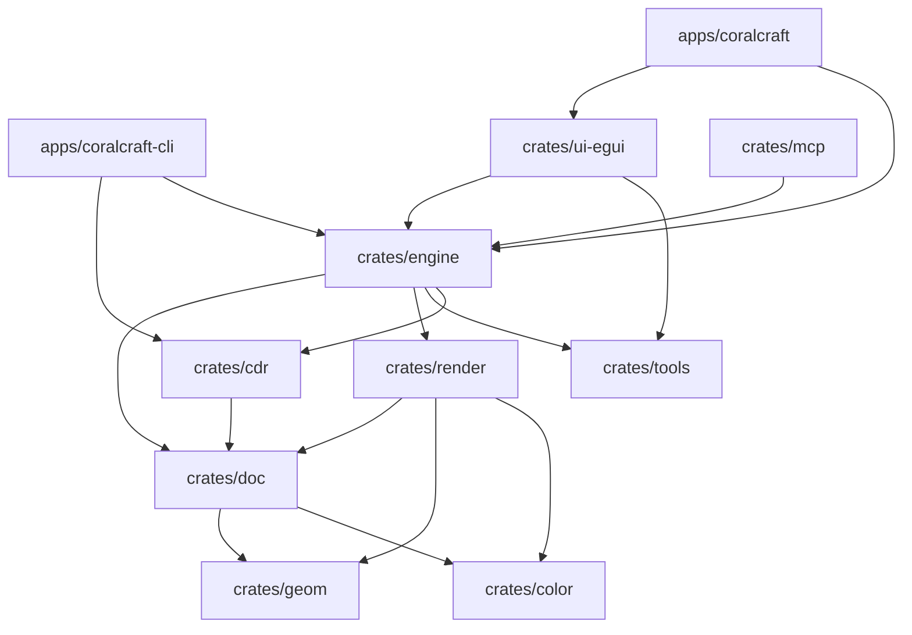

# 02 — 架构、关键决策与依赖关系

## 1. 双轨净室方法论（核心法务与工程边界）

1. **行为轨（公开文档净室）**：
   - 应用行为（工具、面板、命令、快捷键）**只**来自公开文档（官方在线手册、公开用户指南 PDF、出版教程、论坛帖子，引用需附 URL）。
   - **绝对禁止**启动、运行、自动化、截图、反汇编对标商业软件，也**绝对禁止**用对标软件生成测试 fixture。
2. **格式轨（自有样例 + 公开逆向规范）**：
   - 以 [Photopea CDR 规范](https://github.com/photopea/CDR-specification)（`refs/cdr-spec/`）为结构主干；
   - 以 [libcdr](https://github.com/LibreOffice/libcdr)（`refs/libcdr/`，**MPL-2.0**）作为 chunk 语义与版本差异参考（**只读不抄**，结论写入 `docs/reverse/` 日志并注明出处，零代码搬运）；
   - **严禁读取** `refs/uniconvertor/` 源码（**AGPL-3.0** 高危传染，仅参考其公开网页格式清单）；
   - 逆向助手 `refs/morluto-rea/` 与 `refs/rea/` **仅用于分析自有样例或合成 fixture**，永不指向商业软件二进制。

## 2. 关键架构决策（D1–D8）

| 编号 | 决策 | 说明与依据 |
| :--- | :--- | :--- |
| **D1** | 纯 Rust Workspace 矩阵 | 对齐 `storytold/vectorcraft` 布局（`crates/*` + `apps/*` + `xtask`），便于复用 `craft-libs`、`craft-common-actions`、`craft-fonts` 生态约定 |
| **D2** | UI 与引擎解耦（`ui-egui`） | 引擎逻辑下沉在 `doc`/`geom`/`color`/`render`/`tools`/`engine`，UI 独立在 `crates/ui-egui` |
| **D3** | 多页文档模型（`coralcraft-doc`） | 对标 CorelDRAW 的多页/跨页（Page/Spread/Layer）排版范式，参照 `refs/designcraft/` 而非单画板模型 |
| **D4** | 色彩优先级前移（`coralcraft-color`） | 印刷/标识场景刚需 CMYK、专色（Spot Color）与 `.cpl`/XML 色板解析 |
| **D5** | CDR 格式三阶段演进（`coralcraft-cdr`） | `probe`（容器/版本/chunk 走读）→ `parse`（对象树转文档模型 + warning 台账）→ `build`（写出长期战役） |
| **D6** | 敌意输入防御（No Panic） | 所有格式解析器把输入视为不可信数据，一律返回 `Result`，在格式 crate 启用 `#![deny(clippy::unwrap_used)]` |
| **D7** | Agent-native（`coralcraft-mcp`） | 内置 MCP server 与 JSON 控制通道，支持 AI agent 自动化操作与回归验证 |
| **D8** | 字体分仓模式 | 字体文件永不进主仓，参照 `refs/craft-fonts/` 通过可选 `CRAFT_FONTS_DIR` 注入 |

## 3. Crate 依赖关系图

## 4. 外部依赖策略

- **Workspace 共享依赖**（见根 [`Cargo.toml`](../../Cargo.toml)）：
  - `thiserror = "2"`：库层结构化错误定义
  - `serde = { version = "1", features = ["derive"] }` / `serde_json = "1"`：序列化与 CLI `--json` 输出
  - `clap = { version = "4.5", features = ["derive"] }`：CLI 参数解析
- **`xtask` 零第三方依赖**：仅使用 Rust 标准库实现 `ci`、`cleanroom`、`assets` 门禁。
