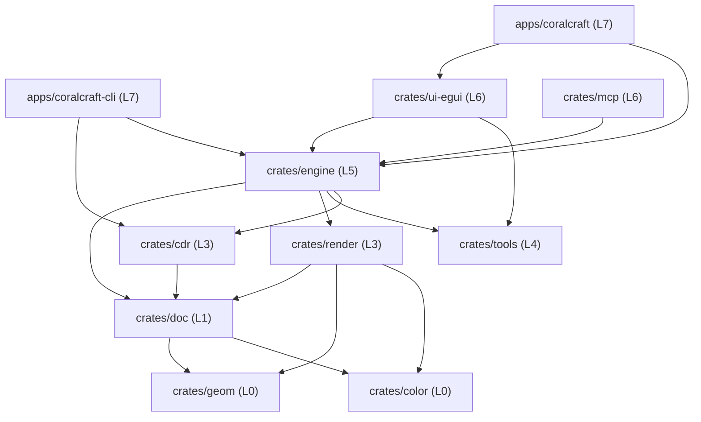

# 02 — Architecture, Key Decisions & Dependency Layers

## 1. Dual-Track Clean-Room Methodology

1. **Behavioral Track (Public Documentation Clean-Room)**:
   - Application workflows (tools, panels, commands, shortcuts) are derived strictly from public documentation (public user guides, published books, tutorials, forum posts, cited with URLs).
   - **Never** launch, run, automate, screenshot, or disassemble proprietary Corel software, and **never** generate test fixtures using proprietary software.
2. **Format Track (Public Specifications + Operator Samples)**:
   - Structural specification backbone: [Photopea CDR Format Specification](https://github.com/photopea/CDR-specification) (`refs/cdr-spec/`) and [Kaitai Struct `coreldraw_cdr.ksy`](https://formats.kaitai.io/coreldraw_cdr/).
   - Semantic reference: [libcdr](https://github.com/LibreOffice/libcdr) (`refs/libcdr/`, **MPL-2.0** — read-only semantic reference, zero code copying; document findings in `docs/reverse/`).
   - **Never** read `refs/uniconvertor/` source code (**AGPL-3.0**).
   - Reverse-engineering assistants (`refs/morluto-rea/`, `refs/rea/`) may **only** inspect operator-owned sample files or synthetic fixtures.

## 2. Key Architectural Decisions (`D1`–`D8`)

| ID | Decision | Rationale |
| :--- | :--- | :--- |
| **D1** | Pure-Rust Layered Workspace (`L0..L7`) | Aligned with `storytold/vectorcraft` (`crates/*` + `apps/*` + `xtask`), enforced by `cargo xtask layers` |
| **D2** | Decoupled UI (`coralcraft-ui-egui`) | Core logic lives in `geom`/`color`/`doc`/`cdr`/`render`/`tools`/`engine`; UI is isolated at `L6` |
| **D3** | Multi-Page Document Model (`coralcraft-doc`) | Models CorelDRAW spreads, per-page dimensions, document-level layer stack, and shared `Desktop` layer |
| **D4** | Early CMYK & Spot Color Support (`coralcraft-color`) | Prepress and signage workflows require CMYK, spot colors, and user-imported `.cpl`/`.xml` palettes |
| **D5** | Three-Stage CDR Format Pipeline (`coralcraft-cdr`) | `probe` (WL / RIFF+RIFX / ZIP+RIFF) -> `parse` (object tree + warning ledger) -> `build` (writer campaign) |
| **D6** | Hostile-Input Hardening (No Panic) | All parsers treat inputs as untrusted, return `Result`, and forbid `unsafe`, `unwrap`, `expect`, and `panic` |
| **D7** | Agent-Native MCP (`coralcraft-mcp`) | Built-in Model Context Protocol server for AI-driven illustration and automated regression testing |
| **D8** | External Font Repository | Fonts are never committed to this repo; injected optionally via `CRAFT_FONTS_DIR` |

## 3. Crate Dependency Graph (`L0`–`L7`)

